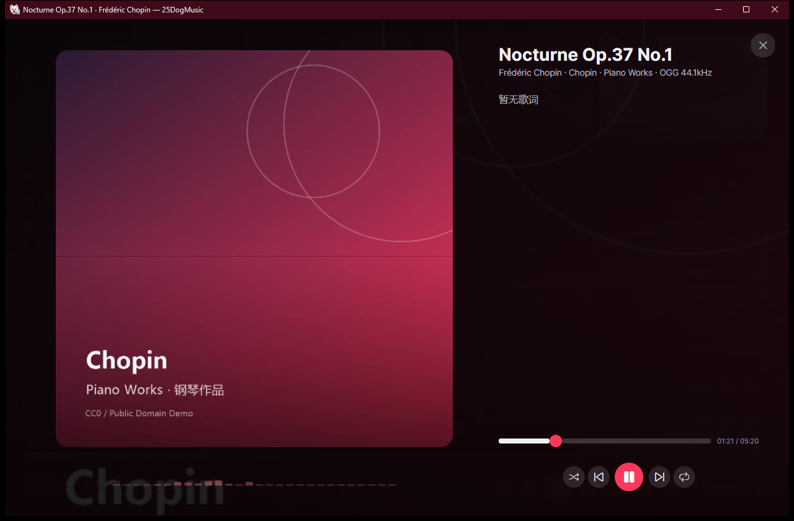

# 25DogMusic

基于 [Avalonia](https://avaloniaui.net/) 的跨平台桌面音乐客户端（Windows / Linux / macOS），连接飞牛 NAS（fnOS）的音乐服务，支持在线浏览、搜索、播放与歌词显示。

[](LICENSE)
[](https://github.com/refout/25DogMusic/releases)
[](https://refout.github.io/25DogMusic/)



## 功能特性

- **音乐库浏览**：专辑、歌手、风格、文件夹、收藏、最近播放，滚动到底自动加载
- **搜索**：按歌曲 / 专辑 / 歌手 / 歌单分类 Tab 展示，列表内部独立滚动分页
- **播放**：全屏播放页、播放队列抽屉、歌单批量添加歌曲抽屉
- **歌词**：全屏歌词跟随高亮，桌面歌词浮窗（仅在当前曲目有歌词时显示，可拖动）
- **频谱 / 均衡器**：基于 WASAPI 环回的实时频谱可视化，内置均衡器预设
- **漫游**：随机漫游曲库，下方展示漫游队列卡片，点击即可切换
- **外观**：深色 / 浅色主题、封面取色背景、Windows 11 云母材质与圆角、Windows 10 标题栏适配
- **设置与关于**：账号与连接、外观、音质与播放分组配置；「关于」页展示版本、开源组件与免责声明，并可一键从 GitHub 检查更新
- **后台播放**：关闭窗口后可继续播放并驻留托盘

## 技术栈

| 组件 | 说明 |
| --- | --- |
| UI | Avalonia 12.1.5（Fluent 主题） |
| 运行时 | .NET 10 |
| 音频 | LibVLCSharp + VideoLAN LibVLC、NAudio |
| 图标 | FluentIcons.Avalonia |
| 终端版 | Terminal.Gui 2.0（`25DogMusic.Tui`，实验性） |

## 目录结构

```
.
├── .github/workflows/   # CI 与 Release（NativeAOT 打包）流水线
├── docs/                # GitHub Pages 站点
└── src/
    ├── 25DogMusic.slnx
    ├── 25DogMusic.Core/       # API 客户端、配置、歌词解析
    ├── 25DogMusic.Desktop/    # Avalonia 桌面客户端
    └── 25DogMusic.Tui/        # 终端界面（实验性）
```

## 本地开发

主要面向 Windows；Linux / macOS 亦可构建与运行，需各自的原生工具链（Linux 需 `clang`、`zlib1g-dev` 与 `libvlc-dev`，macOS 需 Xcode）。环境要求：[.NET 10 SDK](https://dotnet.microsoft.com/download)。

```powershell
# 还原与构建
dotnet build src/25DogMusic.slnx

# 启动桌面客户端
dotnet run --project src/25DogMusic.Desktop
```

首次启动需在登录页填写飞牛 NAS 地址并登录。程序不内置任何服务器地址，登录信息只保存在系统本地应用数据目录下的 `25DogMusic/config.json`（Windows：`%LOCALAPPDATA%\25DogMusic\config.json`，Linux：`~/.local/share/25DogMusic/config.json`，macOS：`~/Library/Application Support/25DogMusic/config.json`）。旧版本的 `FnMusic` 目录会在首次启动时自动迁移。

> 为什么不放在安装目录？安装目录（如 `Program Files`）通常需要管理员权限才能写入，且多用户共用一台机器时每个人的账号与偏好应当独立；放到用户本地数据目录可以做到免提权、按用户隔离，升级或重装程序也不会丢失登录状态。

## 构建与发布

- **CI**：推送到 `main` 或提交 PR 时自动还原并构建 Release（`.github/workflows/ci.yml`）。
- **打包**：推送 `v*` 标签触发 NativeAOT 发布并创建 GitHub Release（`.github/workflows/release.yml`），版本号由标签注入，显示在「关于」页：
  - Windows：`25DogMusic-<版本>-win-x64.zip` 与 `25DogMusic-<版本>-windows-x64-setup.exe` 安装包
  - Linux：`25DogMusic-<版本>-linux-x64.tar.gz`（内置 libvlc，启动脚本 `25DogMusic.sh`）
  - macOS（Apple Silicon）：`25DogMusic-<版本>-macos-arm64.zip`（内置 libvlc 的 `.app`，未签名）
- **纯音频裁剪**：发布时按白名单裁剪 VLC 插件，只保留音频相关模块（Windows 版解压后约 78 MB，压缩包约 34 MB）

```powershell
# 本地 AOT 打包（需安装 VS「使用 C++ 的桌面开发」组件）
dotnet publish src/25DogMusic.Desktop/25DogMusic.Desktop.csproj `
  -c Release -r win-x64 --self-contained true -p:PublishAot=true `
  -o publish/25DogMusic-win-x64
```

## 开源协议与免责声明

本项目以 [MIT 协议](LICENSE) 开源，可自由使用、修改与分发，请保留版权与许可声明。

使用的第三方组件及其许可证见 [THIRD-PARTY-NOTICES.md](THIRD-PARTY-NOTICES.md)。其中播放内核 LibVLCSharp / VideoLAN LibVLC 以 LGPL-2.1-or-later 授权，本项目以动态链接方式使用，发布包内保持独立的库文件，可自行替换。

免责声明：

- 本项目为第三方开源客户端，与飞牛（fnOS）官方无隶属或合作关系。
- 程序仅通过你填写的服务器地址访问你自己的音乐服务，不提供、不分发任何音源内容。
- 请确保所播放内容的来源合法，因使用本程序产生的版权等责任由使用者自行承担。
- 软件按「现状」提供，不附带任何明示或暗示的担保。

## 相关链接

- 项目主页：<https://refout.github.io/25DogMusic/>
- 下载最新版本：<https://github.com/refout/25DogMusic/releases/latest>
- 问题反馈：<https://github.com/refout/25DogMusic/issues>
- 第三方组件说明：[THIRD-PARTY-NOTICES.md](THIRD-PARTY-NOTICES.md)
